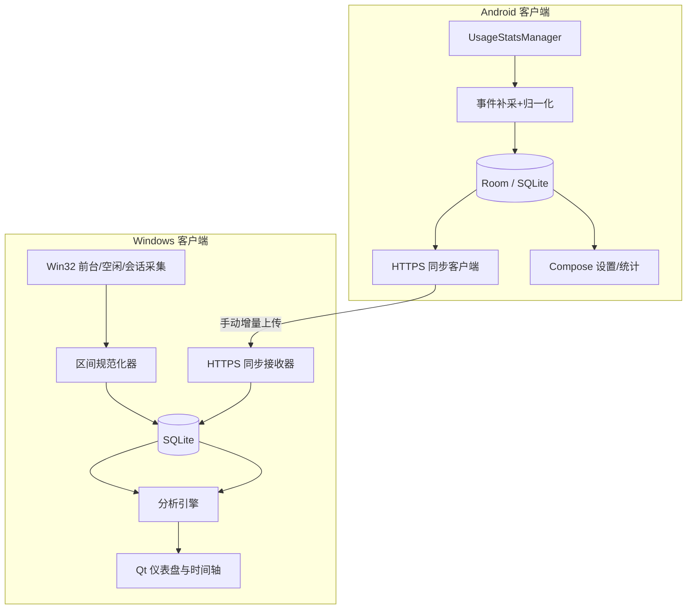

# TimeTrace 技术架构设计（v0.1）

- 状态：拟定方案，尚未实现
- 主要语言：Windows C++20 / Qt6，Android Kotlin / Compose
- 数据架构：双端本地 SQLite，Windows 负责合并可视化，Android 向 Windows 单向增量上传

## 1. 架构决策记录（ADR）

| 决策 | 选择 | 理由 | 代价 |
| --- | --- | --- | --- |
| ADR-001 | Local-first | 不依赖账号、断网可用、隐私优先 | 跨互联网访问尚不支持 |
| ADR-002 | Windows C++20 + Qt Widgets | 复用 C++ 能力、直接访问 Win32 | UI 需两端分别开发 |
| ADR-003 | Android Kotlin + Jetpack Compose | 原生 API、权限与生命周期更易处理 | 另一套语言和项目 |
| ADR-004 | SQLite/Room | 数据本地可查询、事务性强 | 需要 schema migration |
| ADR-005 | 规范化时间段 + 原始游标 | 跨端统一计算与去重 | 需要维护事件归一化逻辑 |
| ADR-006 | 手动局域网单向同步 | v0.1 最小可用、无云服务 | 电脑不在线无法接收 |
| ADR-007 | HTTPS + 指纹确认配对 | 防止同网段第三方读取记录 | 证书、密钥与配对逻辑较复杂 |

## 2. 模块分层



**请注意**：首版只有 Android→Windows 的使用记录同步。Windows 的分类等设置暂时不同步回 Android，避免引入双向冲突解决。

## 3. Windows 事件采集

**主路径（推荐）**：

1. 在有消息循环的线程调用 `SetWinEventHook(EVENT_SYSTEM_FOREGROUND, EVENT_SYSTEM_FOREGROUND, ..., WINEVENT_OUTOFCONTEXT)`，获得前台窗口切换事件。
2. `GetForegroundWindow()` 和 `GetWindowThreadProcessId()` 提取句柄与 PID；查询可用的可执行文件路径/进程名称，标准化为 `app_id`。避免将 PID 用作长期唯一应用标识。
3. 使用 `GetLastInputInfo()` 识别当前用户会话的键鼠空闲；阈值默认 120 秒，作为可配置实验参数，超过阈值的部分不能继续标记为活跃。
4. 用 `WTSRegisterSessionNotification` / `WM_WTSSESSION_CHANGE` 处理锁屏、解锁和注销；监听系统睡眠与唤醒。
5. 兜底轮询（例如每 5 秒）核对当前状态以缓解偶发遗漏，不应仅靠每秒全量轮询。
6. 采集器生成原始状态变化，由区间规范化器负责拆分区间、写入事务，采集回调本身不做磁盘重操作。

**注意**：空闲检测不等于专注度判断。用户观看视频但未动鼠标时可能被视为空闲；v0.1 的“活跃”是统一的统计口径而非行为真相。`GetLastInputInfo` 也只适用于当前调用的用户会话，且输入 tick 值并非绝对单调。

## 4. Android 采集

1. 首次进入明确说明会采集哪些元数据、保存在哪里。用户主动跳转 `Settings.ACTION_USAGE_ACCESS_SETTINGS` 授权，回到应用后用 AppOps 及实际调用复核权限。
2. `UsageStatsManager.queryEvents(begin, end)` 读取系统保留的有限时长原始事件。Android 10+ 使用 `ACTIVITY_RESUMED`/`ACTIVITY_PAUSED`，结合 `SCREEN_INTERACTIVE`、`SCREEN_NON_INTERACTIVE`、`KEYGUARD_SHOWN/HIDDEN` 等信息。
3. 通过状态机将 Activity 事件转换成以包名标识的区间；同一 app 多 Activity 切换、分屏或多窗口情形需合并/标记不确定性，不可简单相加。
4. 采集时采用持久游标 `last_scanned_ms` + 重叠回看窗口（例如 2 分钟），仅对完整可靠区间入库，并为不可判定时间打 `unknown` 标记；保证重新扫描幂等。
5. 进入 App 时主动补采；可用 WorkManager 定期执行补采（建议从每 1 小时尝试）。Android WorkManager 周期任务至少 15 分钟，且 Doze/厂商电池优化可能推迟。不能承诺“每小时准确一次”。
6. 系统事件只保留数天，长时间停机或权限关闭可能造成无法补回的缺口。必须在界面显示“数据不完整”而不是填零。

**安全限制**：不要使用 Accessibility Service、录屏或无关敏感权限来绕过系统限制；v0.1 不需要读取完整浏览记录。

## 5. 数据建模

### activity_segments（规范化完成区间）

```sql
CREATE TABLE activity_segments (
    segment_id       TEXT PRIMARY KEY,
    device_id        TEXT NOT NULL,
    device_seq       INTEGER NOT NULL,
    app_id           TEXT NOT NULL,
    start_ms         INTEGER NOT NULL,
    end_ms           INTEGER NOT NULL,
    source           TEXT NOT NULL,
    confidence       TEXT NOT NULL DEFAULT 'observed',
    created_ms       INTEGER NOT NULL,
    CHECK (end_ms > start_ms),
    UNIQUE (device_id, device_seq)
);
CREATE INDEX idx_segments_time ON activity_segments(start_ms, end_ms);
CREATE INDEX idx_segments_device_time ON activity_segments(device_id, start_ms);
```

- `segment_id`：来源设备生成的 UUID，上传后不可改变，确保重传幂等。
- `device_seq`：每台设备对**已完成**区间分配的递增序号，同步游标使用此序号；已确认序号不可改变对应内容。
- `app_id`：Windows 可执行文件稳定标识或 Android 包名（命名空间建议 `win:...` / `android:...`）。
- `source`：如 `win32_foreground`、`android_usage_events`。
- `confidence`：`observed`、`estimated` 等，`unknown` 数据缺口由另一张 coverage 表记录。
- 不存窗口标题、文本、截图或 URL。原始系统事件如果用于断点恢复，应仅在本地保留必要的有限期摘要。

### supporting tables

- `devices(device_id, platform, display_name, first_seen_ms, last_seen_ms)`。
- `apps(app_id, platform, display_name, category_id)`。
- `collection_coverage(device_id, start_ms, end_ms, status, reason)`：记录是否有足够采集覆盖及原因。
- `sync_peers(peer_id, fingerprint, token_secret_ref, created_ms, revoked_ms)`：凭据存 Windows/Android 系统安全存储，不以明文写日志。
- `sync_cursor(peer_id, device_id, last_acked_seq)`：发送端提交成功后前进。
- `settings(key, value)`：不存储与系统无关的敏感秘密。

Android 数据库可用 Room 实现同构实体；Windows 用 SQLite C API/成熟轻包装，二者对外遵循协议版本即可，内部不要求相同文件结构。

## 6. 局域网配对与同步协议

### 配对

1. 用户在 Windows 点击“开启接收”，Windows 生成本地 HTTPS 证书（或复用之前的设备证书）、随机一次性配对码和设备指纹，监听用户可见端口；用户可随时关闭。
2. Windows 展示 QR（含局域网 IP、端口、服务端证书 SHA-256 指纹、临时配对标识），Android 用户主动扫描或手动输入。
3. Android 连接并校验服务端证书指纹、完成一次性配对码校验；Windows 用户确认设备名称与配对请求。成功后发放可撤销、设备级短期/可轮换凭据。
4. 发送端只向已验证指纹的电脑发数据；服务端对认证失败、重试速率、请求体大小做限制。不要在局域网使用裸 HTTP/默认全网开放接口。

### API（示意）

```http
POST /api/v1/sync/segments
Authorization: Bearer <device_token>
Content-Type: application/json
```

```json
{
  "schema_version": 1,
  "device_id": "f58c3bde-09a8-42ba-815b-f5850754db03",
  "segments": [
    {
      "segment_id": "673b52fa-444e-46ac-bf06-40f5caf008b5",
      "device_seq": 42,
      "app_id": "android:org.mozilla.firefox",
      "start_ms": 1792947600000,
      "end_ms": 1792948200000,
      "source": "android_usage_events",
      "confidence": "observed"
    }
  ]
}
```

```json
{
  "schema_version": 1,
  "accepted": 1,
  "duplicate": 0,
  "acked_through_seq": 42
}
```

- API 根据**设备身份**校验 `device_id`，不能任由请求体自称其他设备。
- 服务端以 `(device_id,device_seq)` 与 `segment_id` 去重，若同键内容不一致应拒绝并告警，不静默覆盖。
- 仅在事务落盘成功且已确认连续序号后返回/推进 `acked_through_seq`；缺口出现时只能确认之前连续部分。
- 客户端仅在验证确认响应后更新游标；超时可以无害重传。
- 单批上限建议 500 条与 1 MiB，HTTP 连接设超时、指数退避。
- 删除语义：v0.1 Windows 仅用于镜像手机历史；删除某台设备数据后应禁止老数据自动再次同步，要求用户显式重置同步游标或解除配对。后续可设计版本化墓碑（tombstone）。

## 7. 时间重叠统计

```text
input: 各设备符合“活跃”条件的区间列表
step1: 清洗非法区间，按选择时区切割每日边界
step2: 每台设备内部 merge overlaps → device_active
step3: sum(duration(device_active)) → cumulative_device_time
step4: union(all device_active) → deduplicated_time
step5: cumulative_device_time - deduplicated_time → duplicate_accounted_time
```

- `[10:00,11:00)` 与 `[10:30,11:30)`：累计 120 分钟，去重 90 分钟，重复计入 30 分钟。
- 分类排行榜允许“按设备累计”而不是跨类别去重，需在 UI 清楚注明口径。
- 对缺失事件不猜测；Windows 采样、Android 多窗口和长时间无采集情况需要显示准确性提示。

## 8. 可靠性与安全

- Windows 在每次状态转换时写入已结束区间；当前未结束区间驻内存并定时 checkpoint，但不应按 checkpoint 直接提交不合理的长区间。
- Android 不依赖 App 进程常驻，使用 UsageEvents 历史+后台补采，权限取消后停止采集。
- 所有长期凭据存储于系统安全存储：Windows DPAPI 或 Credential Manager，Android Keystore/加密存储方案。
- 配对证书身份经 QR 指纹绑定；TLS 防窃听；防重放依靠认证/序号/幂等检查。
- API 默认仅在 Windows “开启接收”期间可用，防火墙规则显式说明；不暴露公网端口。
- 日志默认不包含 URL、窗口名、token、隐私完整事件内容；错误报告用户自主导出。
- 代码审查重点：输入长度校验、数据库 SQL 参数化、私有密钥文件权限、时间戳范围检验、Android 工具链依赖审查。

## 9. 开源仓库建议结构

```text
timetrace/
├─ README.md
├─ LICENSE
├─ CONTRIBUTING.md
├─ SECURITY.md
├─ PRIVACY.md
├─ docs/
│  ├─ PRD.md
│  ├─ ARCHITECTURE.md
│  └─ ROADMAP.md
├─ apps/
│  ├─ windows/             # CMake + Qt6 + C++20
│  │  ├─ src/collector/
│  │  ├─ src/storage/
│  │  ├─ src/sync/
│  │  ├─ src/analytics/
│  │  └─ src/ui/
│  └─ android/             # Gradle + Kotlin + Compose
│     └─ app/src/main/java/.../
├─ protocol/
│  ├─ schema_v1.json
│  └─ examples/
├─ tests/
│  ├─ fixtures/
│  └─ integration/
└─ .github/workflows/
   ├─ windows-ci.yml
   └─ android-ci.yml
```

## 10. 官方参考

- Windows hook: https://learn.microsoft.com/en-us/windows/win32/api/winuser/nf-winuser-setwineventhook
- Windows idle: https://learn.microsoft.com/en-us/windows/win32/api/winuser/nf-winuser-getlastinputinfo
- Windows session: https://learn.microsoft.com/en-us/windows/win32/termserv/wm-wtssession-change
- Android event types: https://developer.android.com/reference/android/app/usage/UsageEvents.Event
- Android usage querying: https://developer.android.com/reference/android/app/usage/UsageStatsManager
- Android Settings: https://developer.android.com/reference/android/provider/Settings
- Android background work: https://developer.android.com/reference/androidx/work/PeriodicWorkRequest
